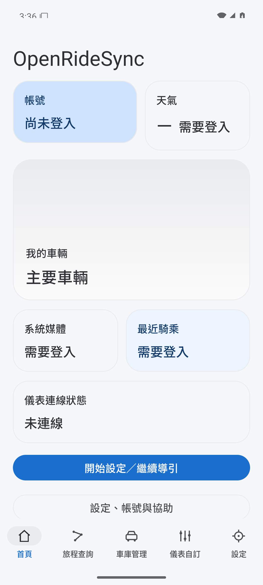
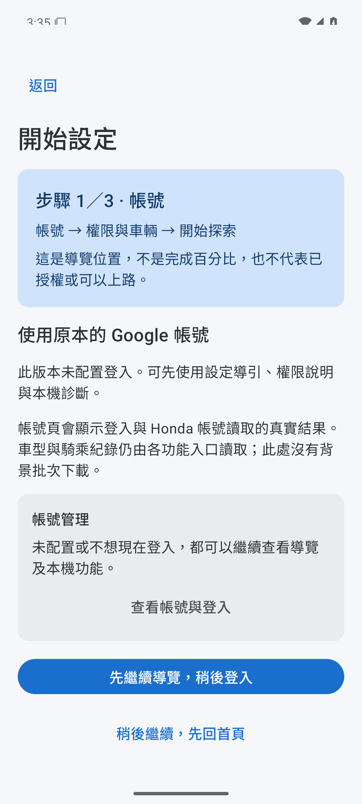
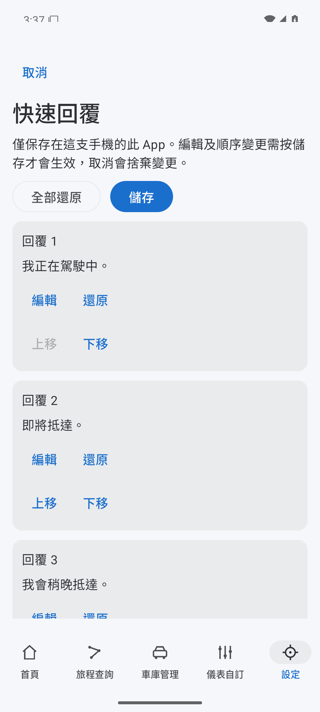
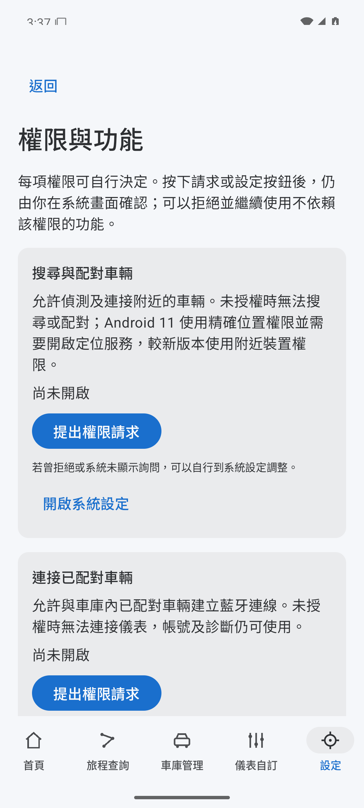
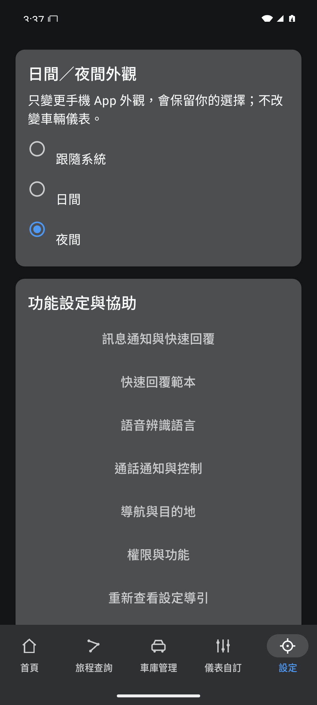
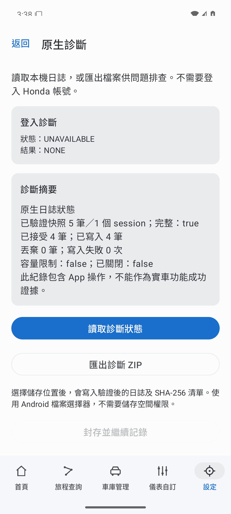

# OpenRideSync

**讓 Android 手機與 Gen1 車載儀表連線的開源騎乘 App。**

[](https://github.com/eddie772tw/OpenRideSync/actions/workflows/android.yml)
[](#相容性與驗證)
[](LICENSE)

[畫面預覽](#畫面預覽) · [功能與開發狀態](#功能與開發狀態) · [快速開始](#快速開始) · [開發與貢獻](#開發與貢獻)

OpenRideSync 面向使用 Honda RoadSync Gen1 通訊的車載儀表，將帳號、車庫、藍牙連線、把手互動、媒體與診斷整合到獨立的 Android App。專案使用 Kotlin、Jetpack Compose 與自行實作的 Java Gen1 encoder，延續既有的車端通訊研究，逐步建立面向使用者的騎乘流程。

> [!NOTE]
> 首個原始碼預發行為 [`v0.1.0-alpha.1`](https://github.com/eddie772tw/OpenRideSync/releases/tag/v0.1.0-alpha.1)，本次不附 APK。OpenRideSync 並非 Honda 官方 App；公開原始碼的預設建置不含原服務登入設定，可查看本機介面、設定導引與診斷，帳號及車輛服務另需適當配置。

## 畫面預覽

以下為 Android 模擬器執行 Alpha 的實際截圖，使用繁體中文、公開圖示與系統字型。畫面取自[首版介面實作](https://github.com/eddie772tw/OpenRideSync/pull/1)，未登入帳號、未連接車輛；空白或未授權狀態依 App 實際結果呈現。

<table>
  <tr>
    <td align="center"><a href="docs/screenshots/home.png"></a><br><b>首頁與功能入口</b></td>
    <td align="center"><a href="docs/screenshots/setup.png"></a><br><b>逐步設定導引</b></td>
    <td align="center"><a href="docs/screenshots/quick-replies.png"></a><br><b>快速回覆範本</b></td>
  </tr>
  <tr>
    <td align="center"><a href="docs/screenshots/permissions.png"></a><br><b>權限與功能說明</b></td>
    <td align="center"><a href="docs/screenshots/settings-dark.png"></a><br><b>日間與夜間外觀</b></td>
    <td align="center"><a href="docs/screenshots/diagnostics.png"></a><br><b>本機診斷與匯出</b></td>
  </tr>
</table>

截圖的版本、來源與擷取條件見[截圖說明](docs/screenshots/README.md)。模擬器畫面展示介面與操作流程，不代表藍牙、車載儀表或實車功能已通過驗收。

## 功能與開發狀態

| 功能 | 目前內容 | 使用條件與驗證範圍 |
| --- | --- | --- |
| 設定與外觀 | 設定導引、功能權限說明、日間／夜間主題、版本與設定資訊 | 本機功能可在未登入時開啟；Alpha 介面持續完善中 |
| 帳號與車庫 | Google／Firebase 登入流程、Honda 帳號與車型資料讀取、已保存車輛管理 | 需要原服務登入設定與實際登入；設定存在不等於登入成功 |
| Gen1 連線與儀表 | 明確配對與連線、Gen1 通訊、儀表畫面資料傳送與把手互動 | 研究基線已有一次基本實車成功；各手機、車型及交付 APK 仍需分別驗證 |
| 媒體與通訊 | 播放器選擇、媒體控制、通話與訊息處理、快速回覆及語音語言設定 | 依功能需要系統授權、登入或可用的第三方 App；完整實車情境仍待驗 |
| 導航與騎乘紀錄 | 導航資料整合、騎乘紀錄讀取、旅程錄製與待傳佇列 | 完整導航及真實旅程採樣、上傳接受與回讀整鏈仍在驗證；錄製與自動上傳預設關閉 |
| 診斷與匯出 | 本機持久紀錄、狀態檢視、由使用者選擇位置的匯出流程 | 查看診斷不需登入；分享前應檢查內容並移除私人資料 |

詳細使用流程見[開始使用](docs/GETTING-STARTED.md)，版本工作見[開發說明](docs/DEVELOPMENT.md)。

## 快速開始

### 了解目前版本

目前提供 [`v0.1.0-alpha.1` 原始碼預發行](https://github.com/eddie772tw/OpenRideSync/releases/tag/v0.1.0-alpha.1)，尚未提供安裝 APK。版本變更見 [CHANGELOG](CHANGELOG.md)。一般使用者可先閱讀[使用流程](docs/GETTING-STARTED.md)與[相容性範圍](docs/COMPATIBILITY.md)；自行建置者請先確認是否需要原服務登入設定，以及 APK 的簽署與升級方式。

### 從原始碼建置

需要 **JDK 17、Android SDK 36、Build Tools 36.0.0**。可使用 Android Studio，或既有的 Android 命令列工具；Gradle Wrapper 已隨專案提供。

1. 取得專案：

   ```sh
   git clone https://github.com/eddie772tw/OpenRideSync.git
   cd OpenRideSync
   ```

2. 設定 `ANDROID_HOME` 指向 Android SDK，或在本機 `local.properties` 填入 `sdk.dir`。

3. 建置預設的未配置 debug APK：

   **macOS／Linux**

   ```sh
   ./gradlew :app:assembleDebug -PwithHondaConfig=false -PwithOemUiAssets=false -PsourceCommit="$(git rev-parse HEAD)"
   ```

   **Windows PowerShell**

   ```powershell
   $sourceCommit = git rev-parse HEAD
   .\gradlew.bat :app:assembleDebug -PwithHondaConfig=false -PwithOemUiAssets=false "-PsourceCommit=$sourceCommit"
   ```

產物位於 `app/build/outputs/apk/debug/app-debug.apk`。預設建置未包含原服務登入設定，可用於查看本機介面、設定導引與診斷；實際登入與車輛服務需要配置。不同簽章的 APK 不能直接作為既有安裝的保留資料更新，升級前請先確認簽署身分。

<details>
<summary>需要原服務登入設定的開發者</summary>

取得適當的 client 設定後，將檔案保存在公開 repo 之外，並明確指定單一檔案：

```sh
./gradlew :app:assembleDebug -PwithHondaConfig=true -PhondaConfigFile=/path/to/private-auth-client.json -PwithOemUiAssets=false -PsourceCommit="$(git rev-parse HEAD)"
```

Windows 請使用 `gradlew.bat` 與上方 PowerShell 的來源版本參數寫法。

建置只接受已定義的 client 設定欄位，會將指定檔案複製到忽略的建置輸出，不會匯入相鄰檔案。請勿放入使用者 token、密碼或服務帳號。此選項不提供原服務授權，也不證明登入成功；OEM 圖片與字型不由公開工程匯入。

</details>

## 相容性與驗證

- **Android**：最低 Android 11（API 30），compile／target API 36。
- **車端**：開發主線為 Gen1.0／Gen1.5。僅對已保存且車型資料支援的車輛明確連線；Gen2 runtime 與 DFU 不在目前範圍。
- **歷史實車結果**：研究基線於 2026 年 10 月 21 日完成一次約 4 分 47 秒的基本連線、儀表與把手互動。這是限定候選與環境的結果，不能推論為所有功能或車型均已驗收。
- **公開工程檢查**：CI 執行核心模組檢查、App 主機測試、lint、App／裝置測試 APK 建置與合成設定檔檢查。裝置測試 APK 的建置成功不代表已在裝置上執行。

首版仍需補齊手機／車型相容性條目、重複連線、至少一次 30 分鐘背景穩定性，以及真實旅程上傳與回讀。完整範圍與放行條件見[相容性與驗收說明](docs/COMPATIBILITY.md)。

## 開發與貢獻

工程包含四個 Gradle 模組，公開建置不需要 OEM APK、反編譯目錄或研究 repo：

| 路徑 | 用途 |
| --- | --- |
| [`app/`](app/) | Compose 介面、Android 服務、Gen1 runtime 與自寫 encoder |
| [`auth-bridge/`](auth-bridge/) | 瀏覽器與 App 之間的本機授權橋接 |
| [`honda/`](honda/) | 服務資料契約、車庫及騎乘資料儲存 |
| [`diagnostics/`](diagnostics/) | 持久診斷、復原與匯出核心 |
| [`tools/`](tools/) | 公開來源、設定及 APK 核對與離線測試工具 |

### 執行檢查

```sh
./gradlew :diagnostics:check :honda:check :auth-bridge:check :app:testDebugUnitTest :app:lintDebug :app:assembleDebug :app:assembleDebugAndroidTest -PwithHondaConfig=false -PwithOemUiAssets=false -PsourceCommit="$(git rev-parse HEAD)"
python -m unittest discover -s tools -p 'test_*.py'
python -m unittest discover -s tools/validation -p 'test_*.py'
python -m unittest discover -s tools/diagnostics -p 'test_*.py'
node tools/auth/login_test.js
python tools/check_public_source.py
```

Windows 使用 `gradlew.bat`，來源版本參數沿用前述 PowerShell 寫法。Python 3 與 Node.js 用於離線工具測試；各檢查的範圍見[建置核對工具說明](tools/validation/README.md)。

歡迎透過 [Issues](https://github.com/eddie772tw/OpenRideSync/issues) 回報問題，或提交改善介面、文件、相容性與測試的 PR。回報時請提供 App 版本／來源、Android 版本、手機與車型，以及可重現步驟；請移除帳號、token、車輛／裝置識別、通知正文、位置與未檢查的原始側錄。

## 授權與資料來源

OpenRideSync 原創程式以 [MIT License](LICENSE) 授權，第三方程式與素材遵循各自授權，詳見[第三方元件聲明](THIRD-PARTY-NOTICES.md)。公開圖示與系統字型用於預設建置。

本庫是後續 App 開發的主要來源；研究來源對照見 [`SOURCE-PROVENANCE.json`](SOURCE-PROVENANCE.json)。原始實車證據、研究候選 APK、OEM 素材、私人設定與簽署材料保留在原私有研究庫，不納入此公開 repo。
